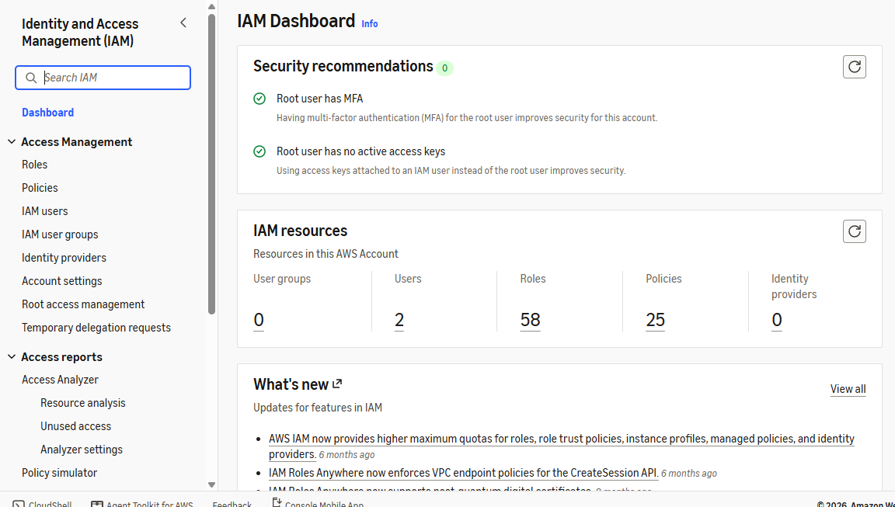
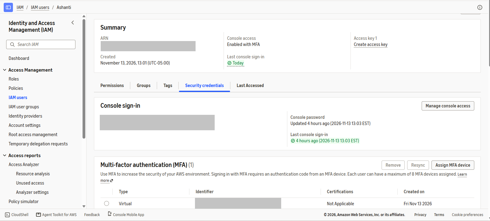

# Lab 0: Stop Using Root

**Goal:** lock away the AWS root account and do all daily work from a dedicated, MFA-protected admin user.

## Why it matters

The root user has unlimited power over an AWS account and can't be restricted by IAM policies. If root credentials are stolen, everything is at risk. AWS recommends using root only for a few account-level tasks.

## What I did

1. **Turned on MFA for the root user**
2. **Confirmed the root user has no access keys**
3. **Created an admin IAM user** with console access
4. **Turned on MFA for the admin user**
5. **Signed out of root** and now work only as the admin user

## Proof

IAM Dashboard → Security recommendations: **0 issues**

- ✅ Root user has MFA
- ✅ Root user has no active access keys

Admin user: **Console access enabled with MFA**

CloudTrail also shows `CheckMfa` events at each admin sign-in, confirming MFA is used.

## What this protects against

- Stolen root password alone isn't enough to get in (MFA required)
- No long-lived root access keys that could leak in code or files
- Everyday mistakes happen as an IAM user whose permissions can be limited, not as the all-powerful root user

---

*Account IDs are hidden in all screenshots.*
