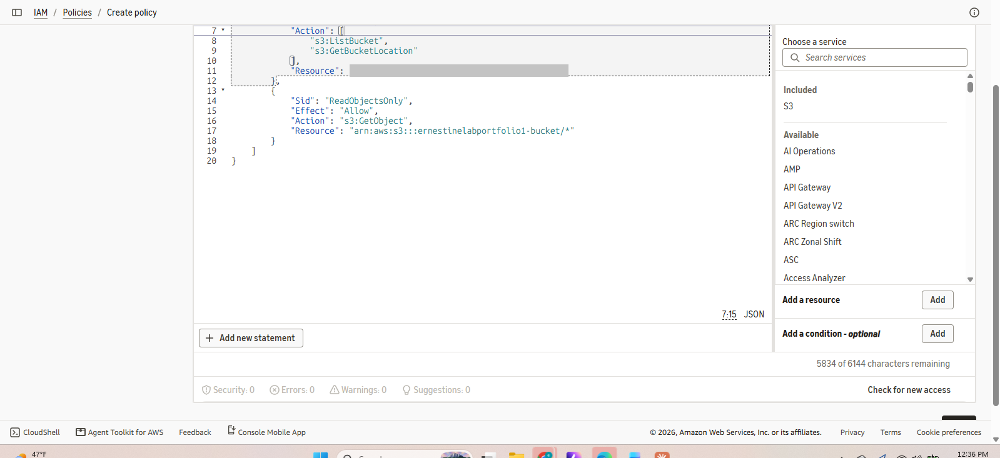
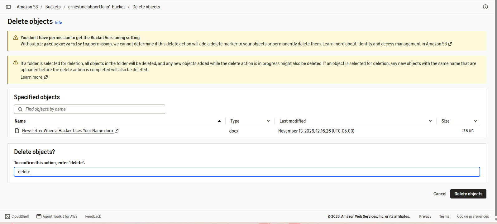
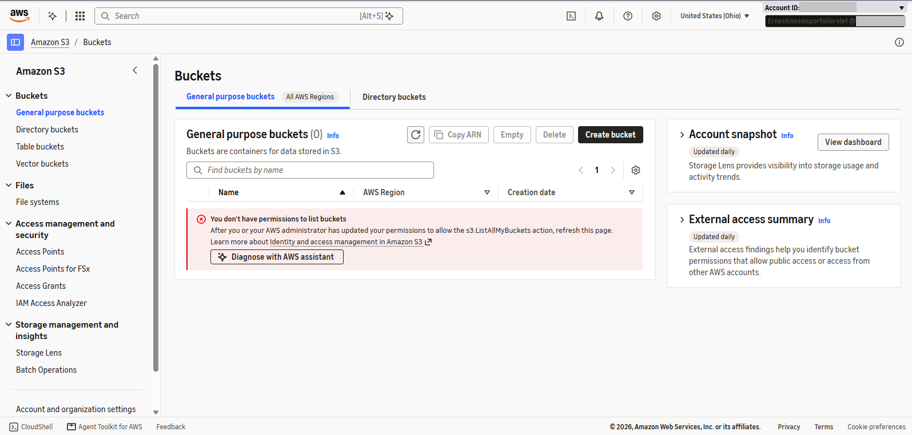
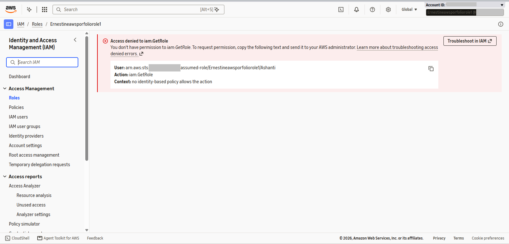
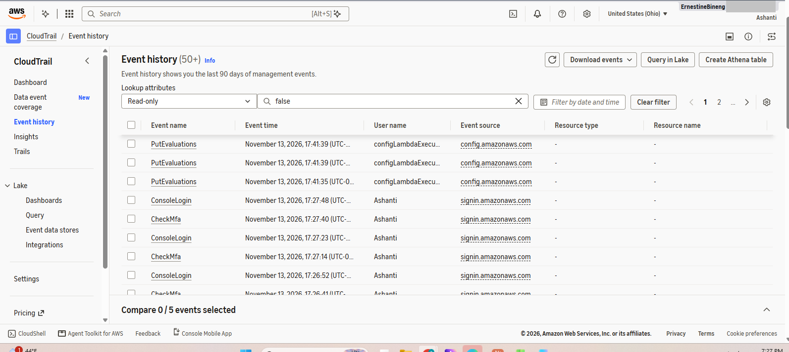

# Lab 1: Least Privilege, Proven Step by Step

**Goal:** give an identity access to exactly one thing, reading files from one S3 bucket, and prove that everything else is blocked.

**Skills shown:** IAM policy writing, IAM roles and trust policies, MFA enforcement, IAM Access Analyzer, CloudTrail auditing

---

## The problem

Many cloud security incidents start with an identity that has more access than it needs. If those credentials are stolen or misused, the damage is limited only by what the identity is allowed to do.

**Least privilege** means granting only the permissions a task requires, and nothing more.

## What I built

| Component | Name | Purpose |
|---|---|---|
| S3 bucket | `ernestinelabportfolio1-bucket` | Stores a test file. Block Public Access is on |
| IAM policy | `readonlypolicyportfolioaws1` | Allows listing and reading this one bucket only |
| IAM role | `Ernestineawsporfoliorole1` | Uses the policy. Can only be assumed with MFA |

Before starting, I completed [Lab 0: Stop Using Root](../lab-0-stop-using-root/), so all work was done from an MFA-protected admin user, not the root account.

### 1. The permissions policy

See [`policy.json`](policy.json).

```json
{
  "Version": "2012-10-17",
  "Statement": [
    {
      "Sid": "ListOneBucket",
      "Effect": "Allow",
      "Action": ["s3:ListBucket", "s3:GetBucketLocation"],
      "Resource": "arn:aws:s3:::ernestinelabportfolio1-bucket"
    },
    {
      "Sid": "ReadObjectsOnly",
      "Effect": "Allow",
      "Action": "s3:GetObject",
      "Resource": "arn:aws:s3:::ernestinelabportfolio1-bucket/*"
    }
  ]
}
```

**Reading it in plain words:**

- **Statement 1** allows listing the contents of one bucket. The resource is the bucket itself.
- **Statement 2** allows reading (downloading) objects in that bucket. The resource ends in `/*`, which means "the objects inside."
- **There is no `Delete`, `Put`, or access to any other bucket or service**, so all of those are denied by default (implicit deny).

**Validation:** IAM Access Analyzer policy validation returned **0 security findings, 0 errors, 0 warnings, 0 suggestions**.



### 2. The role's trust policy (who can use the role)

See [`trust-policy.json`](trust-policy.json).

```json
{
  "Version": "2012-10-17",
  "Statement": [
    {
      "Effect": "Allow",
      "Principal": { "AWS": "arn:aws:iam::123456789012:root" },
      "Action": "sts:AssumeRole",
      "Condition": {
        "Bool": { "aws:MultiFactorAuthPresent": "true" }
      }
    }
  ]
}
```

**Reading it in plain words:** users in this AWS account can switch into the role, **but only if they signed in with MFA**.

> Note: `:root` in the `Principal` means "this AWS account," not the root user. IAM permissions decide which users in the account can actually assume the role.

## How I tested it

I switched into the role from my MFA-protected admin user, then tried actions inside and outside its permissions.

| Test | Expected | Result |
|---|---|---|
| Download the test file from the bucket | Allowed | ✅ Allowed |
| Delete the test file | Denied | ❌ **Access denied** |
| List all buckets in the account | Denied | ❌ Denied (`s3:ListAllMyBuckets` not granted) |
| View the bucket's versioning settings | Denied | ❌ Denied (`s3:GetBucketVersioning` not granted) |
| Open IAM | Denied | ❌ Denied (`iam:GetRole` not granted) |

AWS's own error messages identified the caller as `assumed-role/Ernestineawsporfoliorole1/...`, confirming every test ran as the role.





## Audit trail

In **CloudTrail → Event history**, filtering by event name `SwitchRole` showed exactly when my admin user switched into the role. Every action can be traced back to a person.



## What this protects against

- **Stolen credentials:** an attacker using this role could read one bucket, but couldn't delete data, discover other buckets, or touch other services.
- **Mistakes:** no one using this role can accidentally delete or change data.
- **Unauthorized use:** the role can't be assumed without MFA.

## What I'd add next

- A **bucket policy** that only allows encrypted (HTTPS) connections
- A **permissions boundary** so the role stays limited even if a broader policy is attached by mistake

Both are covered in **Lab 2: Guardrails**.

---

*All account IDs in this repository are replaced with AWS's standard placeholder `123456789012`. No credentials are stored here.*
