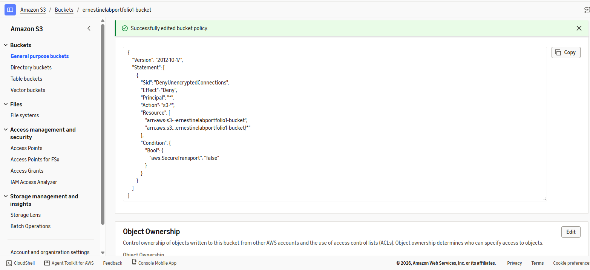
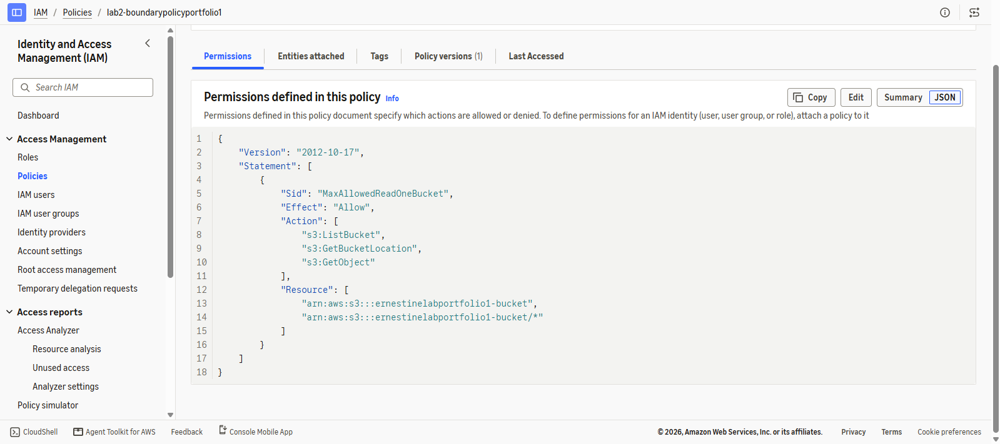
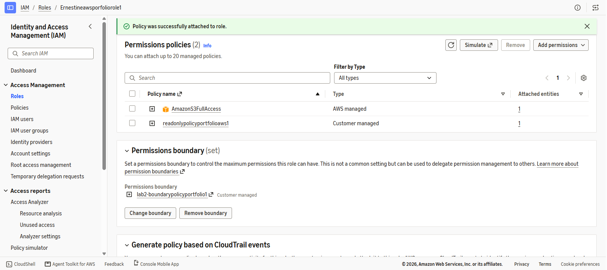
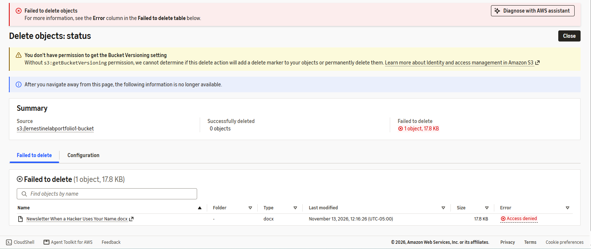

# Lab 2: Guardrails That Hold Even When Mistakes Happen

**Goal:** add two safety nets on top of Lab 1, so data stays protected even if someone connects insecurely or accidentally grants too much access.

**Skills shown:** resource-based policies (S3 bucket policy), explicit deny with conditions, permissions boundaries, IAM policy evaluation, AWS CLI testing in CloudShell

---

## The problem

Lab 1 limited **what the role is allowed to do**. But in real environments, two things often go wrong:

1. **Data is accessed over an unencrypted connection**, where it could be intercepted.
2. **Someone attaches a policy that's too broad**, by mistake or on purpose, and a limited identity suddenly has far more power.

Guardrails are controls that keep working even when that happens.

## Guardrail 1: The bucket protects itself (HTTPS only)

A **bucket policy** is attached to the bucket itself (a resource-based policy), so it applies to **everyone**, including administrators.

See [`bucket-policy.json`](bucket-policy.json).

```json
{
  "Version": "2012-10-17",
  "Statement": [
    {
      "Sid": "DenyUnencryptedConnections",
      "Effect": "Deny",
      "Principal": "*",
      "Action": "s3:*",
      "Resource": [
        "arn:aws:s3:::ernestinelabportfolio1-bucket",
        "arn:aws:s3:::ernestinelabportfolio1-bucket/*"
      ],
      "Condition": {
        "Bool": { "aws:SecureTransport": "false" }
      }
    }
  ]
}
```

**Reading it in plain words:** deny everyone (`*`) every S3 action on this bucket **if** the connection isn't encrypted (`SecureTransport` is `false`).

Because it's an **explicit deny**, it overrides any allow, including an administrator's full permissions.



### Test (AWS CLI in CloudShell, as an admin user)

```bash
# Force an unencrypted (http) connection
aws s3 ls s3://ernestinelabportfolio1-bucket --endpoint-url http://s3.us-east-2.amazonaws.com

# Normal encrypted (https) connection
aws s3 ls s3://ernestinelabportfolio1-bucket
```

| Test | Expected | Result |
|---|---|---|
| List the bucket over **http** (unencrypted), as an admin | Denied | ❌ **AccessDenied**: "explicit deny in a resource-based policy" |
| List the bucket over **https** (encrypted), as an admin | Allowed | ✅ File listed |

## Guardrail 2: A ceiling on the role (permissions boundary)

A **permissions boundary** sets the **maximum** permissions an IAM role can ever have. It doesn't grant anything by itself. It only limits.

See [`permissions-boundary.json`](permissions-boundary.json).

```json
{
  "Version": "2012-10-17",
  "Statement": [
    {
      "Sid": "MaxAllowedReadOneBucket",
      "Effect": "Allow",
      "Action": ["s3:ListBucket", "s3:GetBucketLocation", "s3:GetObject"],
      "Resource": [
        "arn:aws:s3:::ernestinelabportfolio1-bucket",
        "arn:aws:s3:::ernestinelabportfolio1-bucket/*"
      ]
    }
  ]
}
```

**Reading it in plain words:** the most this role can ever do is list, locate, and read this one bucket.

I set this policy (`lab2-boundarypolicyportfolio1`) as the permissions boundary on the Lab 1 role.



### The test: a deliberate mistake

To prove the boundary works, I **attached `AmazonS3FullAccess` to the role on purpose**. On its own, that policy allows every S3 action, including deleting files in any bucket.



**How AWS decides:** an action is allowed only if the role's policies **and** the boundary both allow it.

| Action | Role's policies (`AmazonS3FullAccess`) | Boundary | Result |
|---|---|---|---|
| Read the file | ✅ Allow | ✅ Allow | ✅ **Allowed** |
| View bucket versioning settings | ✅ Allow | ❌ Not listed | ❌ **Denied** |
| Delete the file | ✅ Allow | ❌ Not listed | ❌ **Denied** |

Then I switched into the role and tested:

| Test (as the role, with full S3 access attached) | Result |
|---|---|
| Read the file | ✅ Allowed |
| View bucket versioning | ❌ Denied |
| Delete the file | ❌ **Failed to delete: Access denied** |



**After testing, I removed `AmazonS3FullAccess` from the role** and kept the boundary in place.

## What this protects against

- **Interception:** data in this bucket can't be accessed over an unencrypted connection, by anyone.
- **Mistakes:** if someone attaches an overly broad policy to the role, the boundary keeps it read-only.
- **Privilege escalation:** a common real-world use of boundaries is letting developers create roles safely, without being able to create roles more powerful than allowed.

## Key concepts

| Concept | What I learned |
|---|---|
| **Explicit deny** | A `Deny` always wins over any `Allow`, even for administrators |
| **Resource-based policy** | Attached to the resource (the bucket), so it applies to every caller |
| **Permissions boundary** | A ceiling: effective permissions are where the policies and the boundary overlap |
| **Conditions** | Rules like `aws:SecureTransport` make a statement apply only in certain situations |

## What I'd add next

- **Lab 3:** encrypt the bucket with a **customer-managed KMS key**, so reading data also requires permission to use the key
- **Lab 4:** AWS Organizations and **service control policies (SCPs)**, guardrails at the level of entire accounts

---

*All account IDs are hidden in screenshots. No credentials are stored in this repository.*
