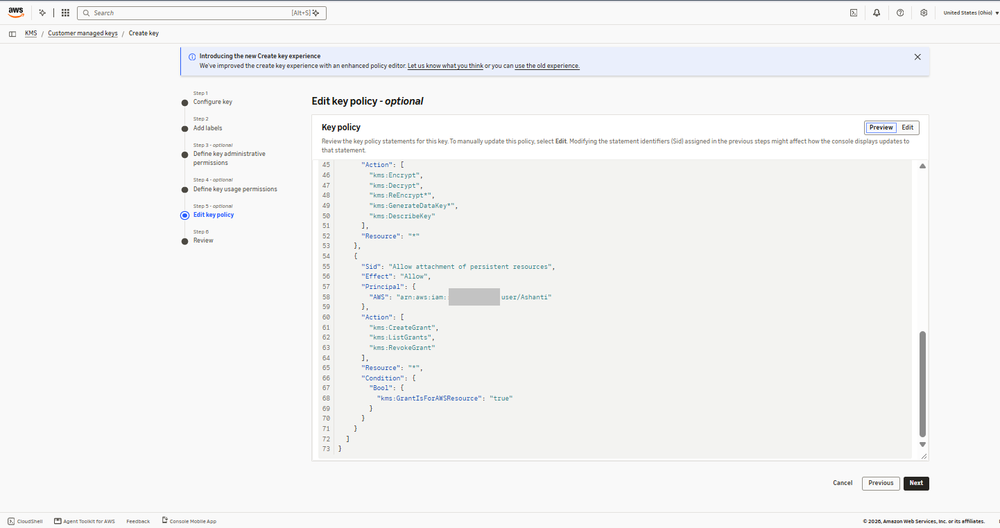
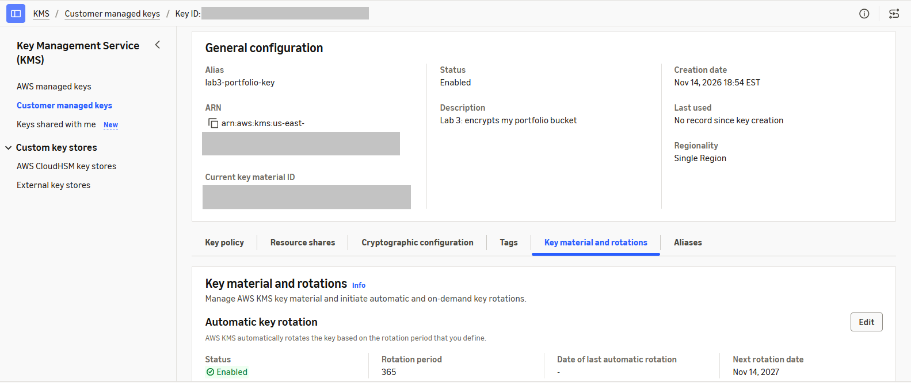
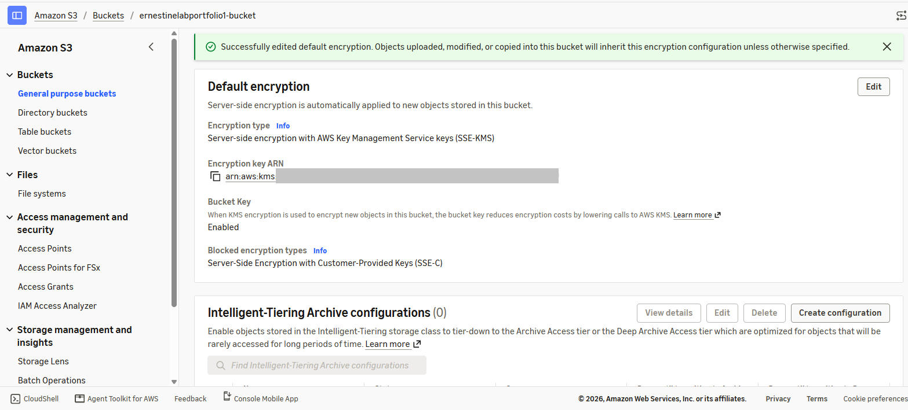
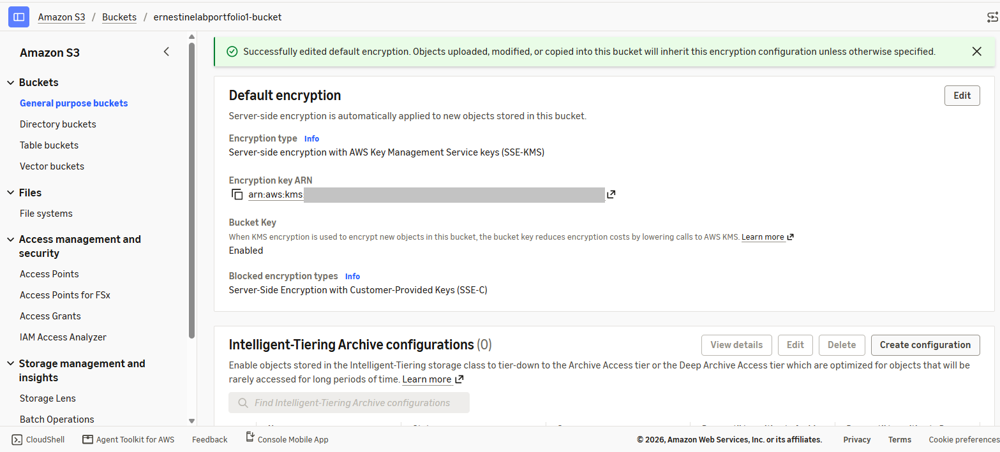
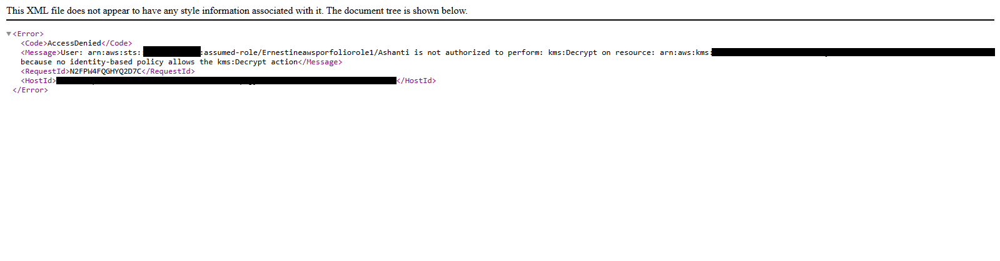
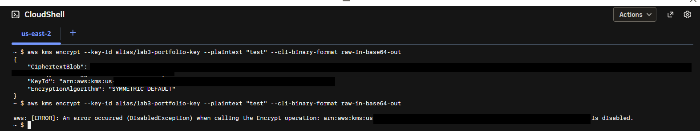
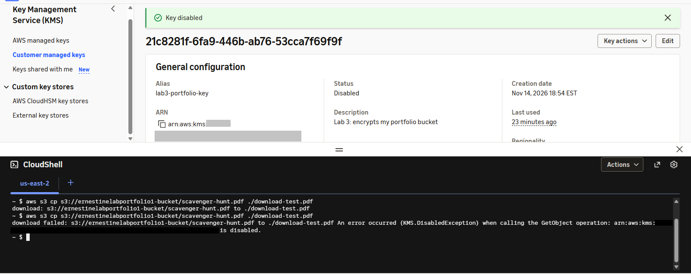

# Lab 3: Data Protection With Your Own Encryption Key (KMS)

**Goal:** encrypt the bucket with a customer-managed key, so reading data requires two permissions: access to the file **and** permission to use the key. Then prove that whoever controls the key controls the data.

**Skills shown:** AWS KMS customer-managed keys, key policies, automatic key rotation, S3 default encryption (SSE-KMS), S3 Bucket Keys, AWS CLI testing in CloudShell, troubleshooting S3 errors

---

## The problem

With default S3 encryption (SSE-S3), AWS manages the key completely. Anyone with S3 read access can read the data, and there's no separate record of who decrypted what.

With a **customer-managed KMS key**, the organization controls the key: who can use it, when it rotates, and whether it's enabled. Every use of the key is logged in CloudTrail.

## What I built

| Component | Setting | Purpose |
|---|---|---|
| KMS key | `lab3-portfolio-key` (symmetric) | Encrypts the bucket's data |
| Key administrators | My admin user | Can manage, rotate, disable, or enable the key |
| Key users | My admin user only | The Lab 1 role was **not** given permission to use the key |
| Automatic rotation | Enabled, every 365 days | New key material yearly, same key ID and alias |
| Bucket default encryption | **SSE-KMS** with `lab3-portfolio-key` | Every new object is encrypted with my key |
| S3 Bucket Key | Enabled | Reduces KMS requests and cost |
| Blocked encryption types | **SSE-C** | Prevents uploads with customer-provided keys, keeping encryption under KMS control |

### The key policy

See [`key-policy-excerpt.json`](key-policy-excerpt.json) (account ID replaced with a placeholder).

| Statement | What it means |
|---|---|
| **Enable IAM User Permissions** | Lets the account's IAM policies decide who can use the key. Without it, even administrators could lose access |
| **Allow access for Key Administrators** | My admin user can manage the key (enable, disable, rotate, change the policy) |
| **Allow use of the key** | My admin user can encrypt and decrypt with it |

> In KMS, the **key policy is the main gatekeeper**. If the key policy doesn't allow access, directly or through IAM, no IAM policy can grant it.





## Choosing an encryption type

| | SSE-S3 | **SSE-KMS (my choice)** | DSSE-KMS |
|---|---|---|---|
| Who manages the key | AWS | **The customer, through KMS** | The customer, through KMS |
| Separate permission needed to decrypt | No | **Yes** | Yes |
| Key use logged in CloudTrail | No | **Yes** | Yes |
| Layers of encryption | 1 | 1 | 2 |
| Typical use | Basic protection | **Sensitive data, compliance, separation of duties** | Strict standards requiring two layers |

## How I tested it

After enabling default encryption, I uploaded a new file, `scavenger-hunt.pdf`. Its properties showed **SSE-KMS** with my key, while the older file in the bucket kept its original **SSE-S3** encryption. Default encryption applies to **new** objects only.



### Test 1: S3 access alone isn't enough

| Who | Action | Result |
|---|---|---|
| Admin user (key user) | Download the KMS-encrypted file | ✅ Allowed |
| Lab 1 role (S3 read access, no key permission) | Download the KMS-encrypted file | ❌ **AccessDenied**: "not authorized to perform `kms:Decrypt`... no identity-based policy allows the `kms:Decrypt` action" |



The role was allowed to read from the bucket by S3, but the request was blocked **at the key**. With SSE-KMS, S3 access alone isn't enough.

The role is also limited by the **permissions boundary from Lab 2**, which doesn't include any KMS actions. Even if `kms:Decrypt` were added to the role's policies, the boundary would still block it.

### Test 2: Whoever controls the key controls the data

I ran the same commands in CloudShell as the **admin user**, with the key enabled and then disabled.

```bash
# Use the key directly
aws kms encrypt --key-id alias/lab3-portfolio-key --plaintext "test" --cli-binary-format raw-in-base64-out

# Read the encrypted file from S3
aws s3 cp s3://ernestinelabportfolio1-bucket/scavenger-hunt.pdf ./download-test.pdf
```

| Key status | Encrypt with the key | Download the encrypted file |
|---|---|---|
| **Enabled** | ✅ Ciphertext returned | ✅ Downloaded |
| **Disabled** | ❌ `DisabledException`: "...key... is disabled" | ❌ `KMS.DisabledException` on `GetObject` |




**Even the administrator couldn't read the data** once the key was disabled. The file stayed in the bucket, fully intact, but unreadable. After I re-enabled the key, access returned.

## Troubleshooting lesson: 404 vs. 403

My first download attempt used the wrong file name and returned **`(404) Not Found`**. That's not a permission problem. It means the object doesn't exist at that name. I listed the bucket to find the exact name:

```bash
aws s3 ls s3://ernestinelabportfolio1-bucket/
```

| Code | Meaning | What to check |
|---|---|---|
| **404 Not Found** | The object doesn't exist at that path | Bucket name, object name, file extension, folder path |
| **403 Access Denied** | The object exists, but the request isn't allowed | IAM policies, bucket policy, permissions boundary, key policy, key status |

## What this protects against

- **Overly broad S3 access:** someone with S3 read permission still can't read KMS-encrypted data without key permission.
- **Unaudited access:** every use of the key is recorded in CloudTrail.
- **Long-lived key material:** automatic rotation replaces key material yearly without breaking access to older data.
- **Loss of control:** disabling the key makes the data unreadable for everyone, which supports incident response and data retirement.

## What I'd add next

- **Lab 4:** AWS Organizations and **service control policies (SCPs)**, guardrails across entire accounts
- A bucket policy that **denies uploads not encrypted with this specific key**
- A CloudTrail review of **KMS Decrypt events** to show who accessed encrypted data

---

*All account IDs are replaced with AWS's placeholder `123456789012` or hidden in screenshots. No credentials are stored in this repository.*
