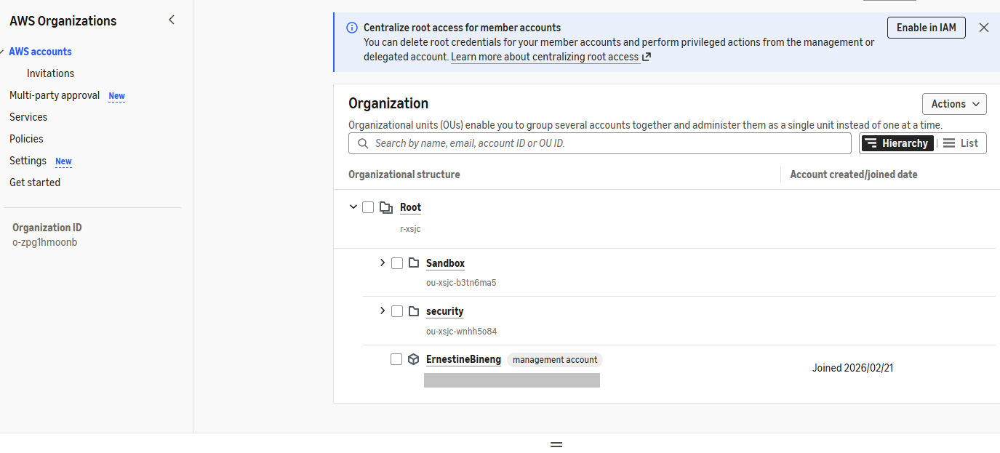
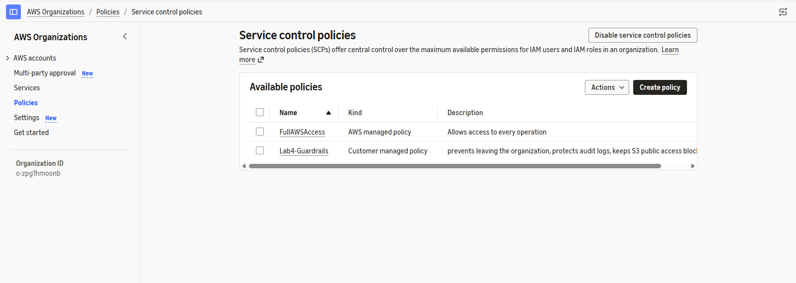
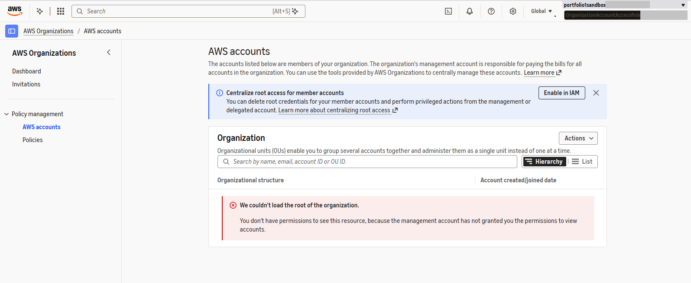
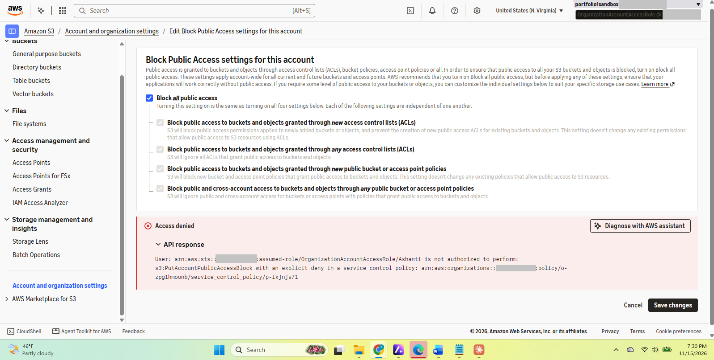
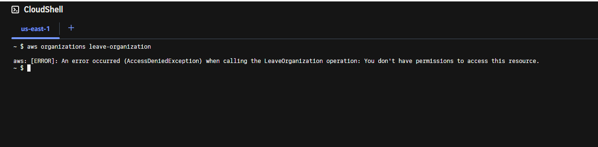
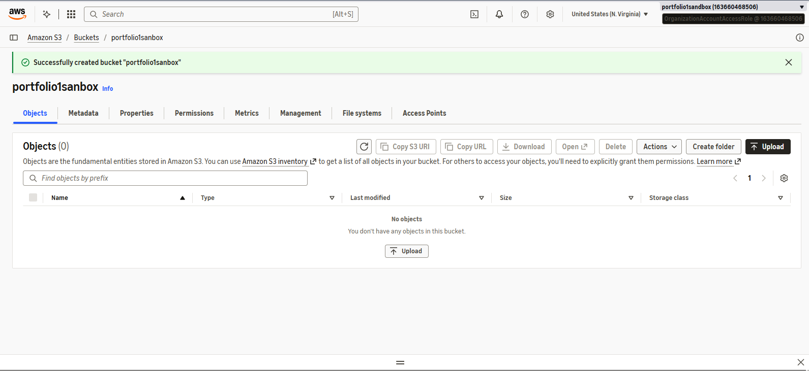

# Lab 4: Multi-Account Guardrails With AWS Organizations and SCPs

**Goal:** apply guardrails at the level of an entire AWS account, so that even the account's own administrators can't disable critical protections.

**Skills shown:** AWS Organizations, organizational units (OUs), service control policies (SCPs), cross-account role switching, account hygiene, AWS CLI testing

---

## The problem

Labs 1–3 protected resources **inside one account**. But organizations usually run many accounts, and each one has its own administrators. An admin, a compromised admin credential, or a simple mistake could:

- Turn off audit logging to hide activity
- Open S3 data to the public
- Remove the account from the organization, escaping all central controls

IAM policies alone can't prevent this, because an account's admins can change IAM. **Service control policies (SCPs)** are set **above** the account, in AWS Organizations, where the account's own admins can't change them.

## What I built

| Component | Setting | Purpose |
|---|---|---|
| Organization structure | Management account at the Root, a **Sandbox** OU | Separates the management account from workloads |
| Sandbox account | Created inside the organization | A member account to apply and test guardrails |
| Access to the sandbox | `OrganizationAccountAccessRole` | Lets my MFA-protected admin user switch into the sandbox as an administrator |
| SCP | `Lab4-Guardrails`, attached to the **Sandbox** OU | Blocks three high-risk actions for every identity in the OU's accounts |
| Default SCP | `FullAWSAccess`, kept attached at every level | SCPs only allow what's explicitly allowed. Removing this would block almost everything |



### Account hygiene first

Before starting, I reviewed the existing organization:

- **Moved the management account back to the Root** (it doesn't need to sit in an OU, and SCPs never apply to it anyway)
- **Deleted empty, unused OUs**
- **Closed an unused member account** that was tied to an email address I might lose access to, removing the risk of an orphaned account

## The SCP

See [`scp-lab4-guardrails.json`](scp-lab4-guardrails.json).

```json
{
  "Version": "2012-10-17",
  "Statement": [
    {
      "Sid": "DenyLeavingOrganization",
      "Effect": "Deny",
      "Action": "organizations:LeaveOrganization",
      "Resource": "*"
    },
    {
      "Sid": "ProtectAuditLogs",
      "Effect": "Deny",
      "Action": ["cloudtrail:StopLogging", "cloudtrail:DeleteTrail", "cloudtrail:UpdateTrail"],
      "Resource": "*"
    },
    {
      "Sid": "KeepS3PublicAccessBlocked",
      "Effect": "Deny",
      "Action": "s3:PutAccountPublicAccessBlock",
      "Resource": "*"
    }
  ]
}
```

**Reading it in plain words:** in any account under this SCP, no one can leave the organization, stop or change audit logging, or change the account-level S3 Block Public Access setting. **Not even an administrator.**



## How I tested it

From the management account, I switched into the sandbox account using `OrganizationAccountAccessRole`, which has **full administrator permissions** in the sandbox.



| Test (as the sandbox administrator) | Expected | Result |
|---|---|---|
| Turn off part of the account's **S3 Block Public Access** | Denied | ❌ **Access denied**: "not authorized to perform `s3:PutAccountPublicAccessBlock` **with an explicit deny in a service control policy**" |
| **Leave the organization** (`aws organizations leave-organization`) | Denied | ❌ **AccessDeniedException** |
| **Create an S3 bucket** (normal admin work) | Allowed | ✅ Created |





**Note on the error messages:** the S3 error **explicitly names the service control policy** as the reason. The Organizations API returns a more **generic** access-denied message, without naming the policy. The S3 result confirms the SCP is being enforced in this account.

## How SCPs fit with what I built earlier

| Control | Applies to | Set by | Can the account's admins change it? |
|---|---|---|---|
| IAM policy (Lab 1) | A user or role | The account's admins | Yes |
| Permissions boundary (Lab 2) | A user or role | The account's admins | Yes |
| Bucket policy (Lab 2) | One resource | The account's admins | Yes |
| KMS key policy (Lab 3) | One key | The key's administrators | Yes |
| **SCP (Lab 4)** | **Entire accounts or OUs** | **The organization's management account** | **No** |

A request is allowed only if **every** layer allows it and **no** layer explicitly denies it.

## Key facts I confirmed

- **SCPs never grant permissions.** They only set the maximum allowed.
- **SCPs apply to everyone in member accounts,** including administrators and the root user.
- **SCPs don't apply to the management account,** which is why testing happens in a member account.
- **Member accounts can't see the organization's structure.** Only the management account can.
- **`FullAWSAccess` must stay attached** at each level (Root, OU, account), or the account loses almost all permissions.

## What this protects against

- **Insider risk and compromised admins:** critical protections can't be turned off from inside the account.
- **Evidence tampering:** CloudTrail logging can't be stopped or changed.
- **Accidental data exposure:** account-level S3 public access protection stays on.
- **Escaping governance:** accounts can't leave the organization and its controls.

## What I'd add next

- **Lab 5:** detection, using CloudTrail and AWS Config rules to flag misconfigurations
- A **region restriction SCP**, limiting workloads to approved AWS Regions
- **Centralized root access** for member accounts, removing root credentials from member accounts entirely

---

*All account IDs, organization IDs, and email addresses are hidden in screenshots. No credentials are stored in this repository.*
